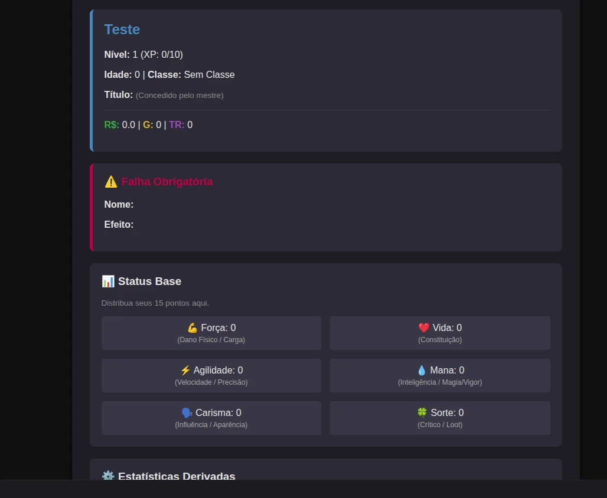
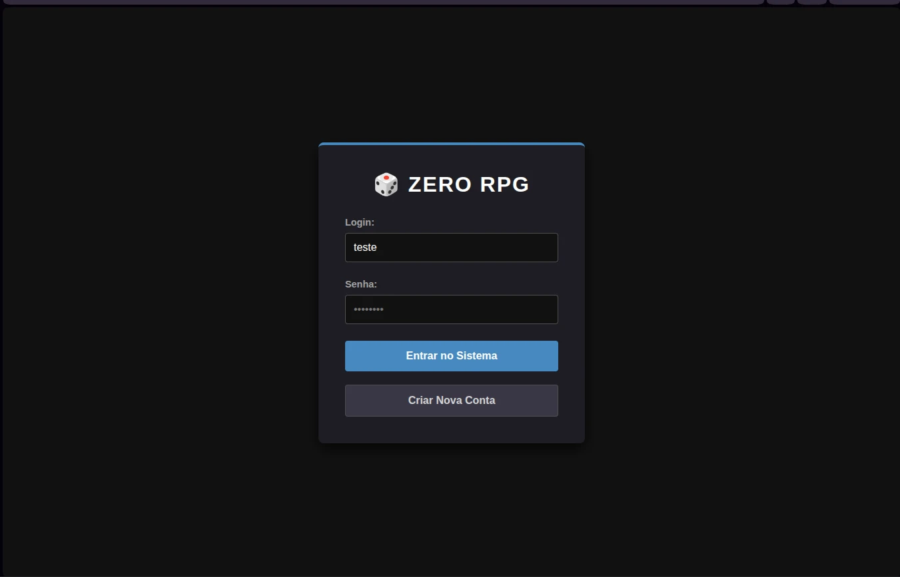
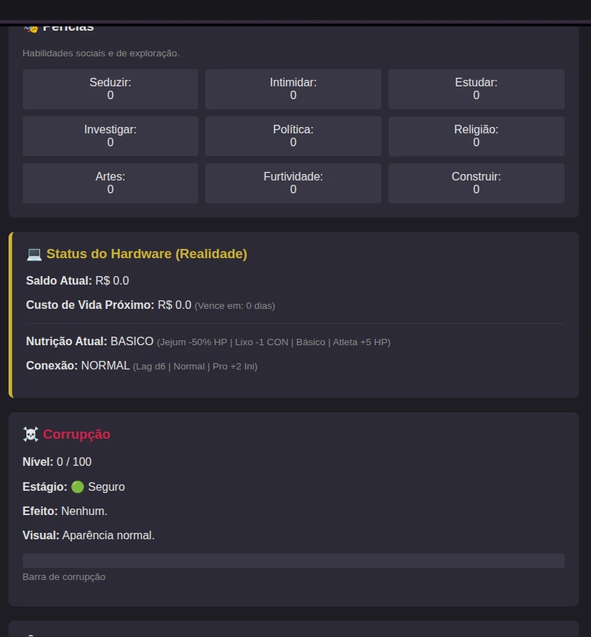

# 🎲 SystemRPG — Plataforma Web de Fichas e Regras de RPG


## Sobre o Projeto

O **SystemRPG** é uma aplicação web e backend desenvolvida em **Java 21 com Spring Boot** para gerenciar fichas, regras matemáticas, economia interna e rolagens em tempo real de um sistema autoral de Tabletop RPG (universo *Zero Life*).

O objetivo do projeto é substituir planilhas manuais por uma plataforma centralizada com separação de perfis (**Mestre** e **Jogador**), garantindo consistência nas regras de progressão, atributos, inventário, corrupção e habilidades.

---

## Prévia da Aplicação

<p align="center">
  
  
</p>

<details>
<summary>Ver mais telas (Login, Criação de Ficha e Painel de Realidade)</summary>

<p align="center">
  
  
</p>
<p align="center">
  
</p>

</details>

---

## Principais Funcionalidades

- **Autenticação e Perfis de Acesso:** Cadastro e login com **Spring Security** e senhas protegidas por hash **BCrypt**, diferenciando painéis de **Jogador** e **Mestre** (controle de NPCs, monstros e bosses).
- **Gerenciamento de Fichas e Classes:** Criação e edição de personagens com atributos, perícias, classes base/híbridas, evolução de nível/XP e associação de habilidades.
- **Rolagem de Dados em Tempo Real:** Integração via **WebSockets** para disparar e sincronizar rolagens entre participantes da sessão.
- **Sistema Dinâmico de Corrupção:** Controle de acúmulo e abatimento de corrupção com regras ligadas a eventos da campanha e evolução do personagem.
- **Motor Econômico e Inventário:** Gestão de moedas do sistema (`Gold`, `Tron` e saldo real), custo de vida e controle relacional de itens/equipamentos.
- **Manual de Regras Integrado:** Consulta organizada por categorias diretamente na interface web.

---

## Arquitetura e Estrutura

```text
SystemRPG/
├── zero/                          # Aplicação Maven / Spring Boot
│   ├── src/main/java/com/rpgsystem/zero/
│   │   ├── config/                # Segurança, CORS e WebSocket
│   │   ├── controller/            # Endpoints Web/REST (Login, Fichas, Mestre, Dados)
│   │   ├── database/              # Conexão JDBC e inicialização
│   │   ├── model/                 # Entidades do domínio (Ficha, Classe, Habilidade, ItemRPG, Corrupcao)
│   │   └── ...
│   ├── src/main/resources/
│   │   ├── templates/             # Views Thymeleaf (painel-player, painel-mestre, inventario, manual...)
│   │   ├── static/                # Estilos CSS e scripts do cliente
│   │   └── application.properties # Configuração parametrizada por variáveis de ambiente
│   ├── .env.example               # Modelo de variáveis de ambiente
│   └── pom.xml
├── schema.sql                     # Script de criação das tabelas MySQL
├── sys.csv                        # Dicionário de dados das tabelas e colunas
├── Dockerfile                     # Build multi-stage com Maven + Eclipse Temurin 21
├── render.yaml                    # Blueprint de deploy para Render
└── Documentacao_Sistema_RPG.md    # Documentação de regras e modelagem do sistema
```

---

## Tecnologias Utilizadas

- **Backend:** Java 21, Spring Boot 3.2.5, Spring Web, Spring Security (`BCrypt`), Spring Data JPA, Spring Mail
- **Tempo Real & Views:** Spring WebSocket, Thymeleaf, HTML5, CSS3, JavaScript
- **Banco de Dados:** MySQL (`mysql-connector-j`), compatível com **TiDB Cloud** via TLS
- **Build & Deploy:** Maven, Docker (multi-stage), Render (`render.yaml`)

---

## Segurança e Variáveis de Ambiente

- As senhas de usuários são armazenadas com hash **BCrypt**.
- O arquivo `zero/src/main/resources/application.properties` lê todas as credenciais a partir de **variáveis de ambiente** (`${DB_URL}`, `${DB_USERNAME}`, `${DB_PASSWORD}`, `${PORT}`), sem segredos fixos no código.
- O arquivo `.env` local é ignorado pelo Git (`.gitignore`). Utilize `zero/.env.example` apenas como modelo de referência.

| Variável | Descrição | Padrão |
| :--- | :--- | :--- |
| `PORT` | Porta HTTP do servidor Spring Boot | `4000` |
| `DB_URL` | String JDBC do banco MySQL / TiDB | `jdbc:mysql://localhost:3306/system_rpg` |
| `DB_USERNAME` | Usuário do banco de dados | `root` |
| `DB_PASSWORD` | Senha do banco de dados | *(vazio)* |
| `SMTP_EMAIL` / `SMTP_PASSWORD` | Credenciais SMTP para envio de e-mail | *(opcional)* |
| `SMTP_HOST` / `SMTP_PORT` | Host e porta SMTP | `smtp.gmail.com` / `587` |
| `ALLOWED_ORIGINS` | Origens permitidas no CORS | `http://localhost:4000` |

---

## Como Executar Localmente

### Pré-requisitos

- **Java JDK 21+**
- **Maven 3.9+** (ou o wrapper `./mvnw` incluído em `zero/`)
- **MySQL 8+** (ou instância compatível com MySQL/TiDB)

### 1. Prepare o banco de dados

Crie o banco `system_rpg` e importe o schema inicial:

```bash
mysql -u root -p -e "CREATE DATABASE IF NOT EXISTS system_rpg;"
mysql -u root -p system_rpg < schema.sql
```

### 2. Configure as variáveis de ambiente

Copie o arquivo de exemplo e preencha suas credenciais locais:

```bash
cp zero/.env.example zero/.env
```

Exporte as variáveis no terminal (ou carregue pelo seu IDE/ambiente):

```bash
export DB_URL="jdbc:mysql://localhost:3306/system_rpg"
export DB_USERNAME="root"
export DB_PASSWORD="sua_senha"
export PORT=4000
```

### 3. Execute a aplicação

```bash
cd zero
./mvnw spring-boot:run
```

A aplicação ficará disponível em **`http://localhost:4000`** (ou na porta definida na variável `PORT`).

### Executar com Docker

```bash
docker build -t systemrpg .
docker run --rm -p 4000:4000 \
  -e PORT=4000 \
  -e DB_URL="jdbc:mysql://host.docker.internal:3306/system_rpg" \
  -e DB_USERNAME="root" \
  -e DB_PASSWORD="sua_senha" \
  systemrpg
```

---

## Licença

Distribuído sob a licença **MIT**. Consulte o arquivo [LICENSE](./LICENSE) para mais detalhes.
